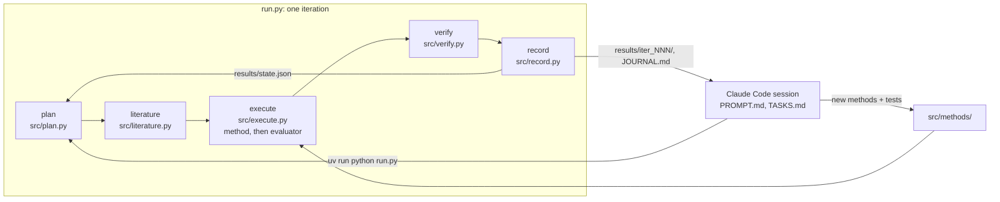

# micrograph-impact-lab

A research loop that tunes a classical grain segmentation pipeline on optical micrographs of metals,
built at the [Claude Impact Lab Berlin 2026](https://github.com/xemantic/claude-impact-lab-2026)
(Claude Community × Foresight Institute).

Team: Ivan Logutov (engineer) and Cesare Garberino (scientist, materials).

**In one paragraph.**
On real 316L stainless steel, the loop brought the dev error from 12.9 (untuned baseline) to **0.126**.
That is the larger of the median count error and the median size error.
It did not reach the 10 % target: the median count error is 0.111 and the median size error 0.126.
On a synthetic testbed, the pooled dev error reached **0.061**.
Two of six grain morphologies stay above 10 %, so the 10 % target is met on average, not for every kind of microstructure.
Noise level showed no detectable trend.
Scratches and pores were found only in part on the testbed (at best 47 % of scratches, 64 % of pores).
On real images, the scratch filter as built made things worse.
Holdout results: [HOLDOUT — filled in after `run.py --final`].

## Question

> Can an agent loop tune a classical grain segmentation pipeline so that grain count and mean grain size on optical micrographs match ground truth within 10%,
> and how does accuracy degrade with image noise,
> and can scratches and pores be detected and kept from corrupting the grain measurements?

- **Why it is still open:**
  - Classical segmentation (threshold + watershed) needs hand-tuned parameters per material and image quality.
  - The tuning is manual and rarely reported with error bars against ground truth.
- **Why it matters:** grain size governs the strength and toughness of metals (Hall–Petch),
  and it is still often measured by hand on optical micrographs.
- **How a result is checked by computation:** an evaluator compares the pipeline's grains with ground truth.
  - Real 316L stainless steel, against expert grain-boundary masks.
  - Synthetic micrographs, against exact per-grain labels and defect masks.
  - The loop tunes on a dev split; a holdout split is used once, at the end.
- **Design: code measures, Claude tunes.**
  - A scikit-image pipeline segments the grains and measures them.
  - Claude plans the next experiment and chooses its parameters.
  - Claude reviews the metrics and the contour drawings.
  - Claude never estimates a size from pixels.

## The loop

Two loops work together.

- **Inner loop: `run.py`, through the Claude API.** Each iteration leaves one directory of evidence in `results/iter_NNN/`.
- **Outer loop: a Claude Code session following [PROMPT.md](PROMPT.md).** It reads the reviews, writes the methods the planner asks for (tests first), and runs the inner loop again.



| Step | What it does | Claude |
|---|---|---|
| plan | picks a falsifiable hypothesis, one of the existing methods and its parameters; every iteration is judged by the fixed project target `max_rel_error <= 0.10` (`target` in config.yaml) | planner |
| literature | searches the web for prior work, once per dataset (`steps.literature: first_only`) | librarian, web search |
| execute | runs the method on the **dev** images; `src/evaluate.py`, the only code that reads ground truth, scores its grains and defects | none |
| verify | checks the target and the method's sanity checks, then asks for a critical review with contour drawings of three dev images attached | reviewer |
| record | writes `summary.json`, updates `results/state.json`, appends to JOURNAL.md | none |

**Metrics** (`src/evaluate.py`):
- `max_rel_error`, the target: the larger of the median count error and the median size error over the dev images.
  - Count: predicted vs true grains, edge grains included.
  - Size: mean equivalent diameter of grains not touching the edge, on both sides.
- `by_family`, synthetic only: the same per grain morphology, with each family's error by noise level.
- `worst_family_rel_error`: the worst family's error.
- For scratches and pores: pixel precision, recall and F1, and the fraction of true defects found.

**Guards against fooling ourselves:**
- `tests/test_leakage.py` fails if a method mentions ground truth, the split or the holdout.
- The split is fixed in [data/splits.json](data/splits.json).
- The planner does not choose the pass threshold.
- `run.py --final` runs once per dataset and refuses a second run.

## Data

The dataset stays outside the repository.
Set `MICROGRAPHS_DIR` to the folder that holds it (it overrides `paths.dataset` in [config.yaml](config.yaml)).
The folder must contain:

```
$MICROGRAPHS_DIR/
├── 02_316L_stainless_with_grain_masks/Grain/{val,test}/{images,masks}/
└── 90_SYNTHETIC_exact_ground_truth/{corrupted,labels_grain,artifact_mask}/, ground_truth_images.csv, ground_truth_grains.csv
```

**316L stainless steel: the real data, where the main claim is measured.**
- 816 optical images, 400×300 RGB, with expert masks (1 = grain interior, 0 = boundary).
  Warren et al. 2024, [Zenodo 10.5281/zenodo.22039777](https://doi.org/10.5281/zenodo.22039777), CC BY 4.0; download it from there.
- Ground-truth grains are the 4-connected components of mask = 1.
  There is no scale bar, so sizes are in pixels.
- Dev = the dataset's `val` folder (40 images); holdout = `test` (165); `train` is not used.
  Two `train` images are in [data/sample/](data/sample/README.md) for the tests.

**Synthetic set: a tuning testbed, not evidence.**
- 48 grayscale images, 1024×768, with exact per-grain labels and defect masks.
- **Provenance:** the scientist generated it on the day with AI prompts and edited it by hand.
  Neither the prompts nor any generator code exist, and its licence is unknown.
  So the images are not redistributed, and no result on them is evidence about real metals.
  It is used because its ground truth is exact and it has defect masks.
- Checked against the files (all 36 complete rows):
  - `n_grains` counts all grains, edge-touching ones included.
  - `mean_eq_diameter_um` averages only grains not touching the edge.
  - The evaluator follows both conventions.
- The 12 `magset*` images (other scales, no per-grain rows) are excluded.
  The other 36 are split per family: 24 dev, 12 holdout.
- Defect codes in `artifact_mask/`, checked on 12 dev images:
  - 60: scratches (thin lines, median 418 px long; bright or dark).
  - 120: pores (small, round, very dark).
  - 180 and 240 are not scored; their meaning is unconfirmed.

## How to run

Requires [uv](https://docs.astral.sh/uv/).

```shell
uv sync
uv run pytest                                    # 42 tests, no API calls, no dataset needed
export MICROGRAPHS_DIR=/path/to/hackathon_micrographs
uv run python run.py --dry-run                   # one iteration with canned answers, written to results/_dry_run/
uv run python -m src.execute --dataset 316L --out results/baseline/316L   # the method alone on dev, no API
```

A live run calls the Claude API and is billed: about $0.25 per iteration, and about $0.40–0.80 when the literature step runs.
It needs `ANTHROPIC_API_KEY` in the environment, or an `ant auth login` profile.

```shell
uv run python run.py -n 3 --dataset 316L         # three planned iterations on the 316L dev split
uv run python run.py --dataset 316L --params '{"sigma": 4.0, "line_width_px": 15}'   # one iteration with fixed params
uv run python run.py --final --dataset 316L      # once, at the end: the best dev iteration on the holdout split
```

The outer loop runs in [Claude Code](https://claude.com/claude-code):

```
/loop 20m read @PROMPT.md and follow the instructions in it
```

## Results

All numbers come from `results/iter_NNN/execute.json`.
Each iteration's reviewer verdict is in its `verify.json`; the reasoning behind each step is in [JOURNAL.md](JOURNAL.md).

### 316L stainless steel (real images, 40 dev images)

| Run | What changed | max_rel_error | Count error (bias) | Size error |
|---|---|---|---|---|
| [baseline](results/baseline/316L/execute.json) | default params | 12.9 | +12.9 | 0.68 |
| [6](results/iter_006/) | best synthetic params | 2.88 | +2.88 | 0.44 |
| [7](results/iter_007/) | everything scaled to ~80 px grains (sigma 4, top-hat 15, h-maxima h 5, min area 1500) | **0.235** | +0.235 | 0.11 |
| [8](results/iter_008/) | peak markers instead of h-maxima | 0.282 | +0.282 | 0.11 |
| [11](results/iter_011/) | iteration 7 with `fill_boundaries=false`, matching masks that leave boundary pixels out | **0.126** | +0.065 (median abs 0.111) | 0.126 |
| [12](results/iter_012/) | iteration 11 + scratch filter (min length 175 px) | 0.167 | +0.167 | 0.12 |
| holdout (165 images) | best dev config, once | [HOLDOUT] | | |

Two changes did most of the work.
- Scaling every length to the real grain size (about 80 px): 2.88 → 0.235.
- Leaving boundary pixels unassigned, as the expert masks do: 0.235 → 0.126.

The reviewer of iteration 7 found that predicted grain sizes sit in a narrow band (70–108 px) while true sizes span 52–123 px:
no single global setting fits both the fine-grained and the coarse-grained images.
The scratch filter (iteration 12) marked 1,233 false "scratches" in the wide dark boundary bands; 316L has no defect ground truth to measure this against.

### Synthetic testbed (24 dev images, 6 morphologies)

| Iteration | What changed | max_rel_error (pooled) | Worst family |
|---|---|---|---|
| [1](results/iter_001/) | defaults | 0.333 | columnar, count +282 % on one image |
| [2](results/iter_002/) | reviewer's grid: wider marker spacing, sigma 2 | 0.076 | columnar 0.514 |
| [4](results/iter_004/) | h-maxima markers (new method, written by the outer loop) | 0.079 | equiaxed 0.204 |
| [5](results/iter_005/) | h-maxima h 3 | 0.066 | equiaxed 0.183 |
| [9](results/iter_009/) | + scratch and pore detection | 0.075 | columnar 0.183 |
| [10](results/iter_010/) | + long-scratch detection only | **0.061** | elongated 0.150 |
| holdout (12 images) | best dev config, once | [HOLDOUT] | [HOLDOUT] |

- **The loop at work.** The reviewer saw from the contour drawings that peak markers cut elongated grains into "ladders".
  The outer loop added h-maxima markers (test first), and the columnar error fell from 0.514 to 0.04–0.06.
- **Noise.** Read within each morphology (iteration 5, `by_family[f].by_level`), the error shows no monotonic trend over corruption levels 0.15–0.95.
  With one image per morphology and level, a trend smaller than about ±5–10 points cannot be detected.
- **Defects** (iterations 9–10):

  | Iteration | Scratches found (precision) | Pores found (precision) |
  |---|---|---|
  | 9 | 47 % (0.39) | 64 % (0.17) |
  | 10 | 9 % (0.96) | off |

  - Taking defects out of the boundary map helped equiaxed and elongated grains.
  - In iteration 9, the scratch detector also took chains of straight columnar grain boundaries for scratches, and those grains merged.
  - Most false pores are dark triple junctions, where boundaries meet.

### Where it got stuck

- **316L.** The best configuration still misses 10 % on count (0.111) and size (0.126).
  The pipeline has one global scale, but the images range from fine to coarse grains.
  The scratch detector does not transfer to real images: its line map picks up the wide boundary bands.
- **Synthetic.** Equiaxed and elongated grains over-count by 13–15 % in iteration 10, the best run.
  The reviewer says no parameter of the current method separates them, and asks for new methods:
  - a thin-ridge scratch detector;
  - a stricter pore test.
- **The pooled metric can pass while a morphology fails.** This is why `by_family` and `worst_family_rel_error` were added.

### Limitations

- **Small dev sets.** The 316L dev set has 40 images. The synthetic dev set has 24, with 4 per morphology and 1 per morphology and noise level.
- **Interior-only size on 316L.** The images are small relative to the grains. Size is measured on grains not touching the edge:
  - one dev image has none, and is left out of the size median;
  - one has only one.
- **Literature.** The literature step's URLs are search results it retrieved; its text carries no per-claim citations.
- **One method family.** Only classical watershed was tried; no learned segmentation.
- **Bugs found on the way.** Each is recorded in JOURNAL.md next to the result it affected:
  - a NaN in a size median;
  - an iteration lost to a stray parameter;
  - a planner that set its own pass threshold.
- **Hand-fixed iterations.** Iterations 11 and 12 were fixed by the outer loop (`run.py --params`), not chosen by the planner; `plan.json` says so.
- **Cost.** Iterations 1–12 cost about $3.10 in API calls.

## Repository

| Path | What it is |
|---|---|
| [config.yaml](config.yaml) | the question, the target, models, limits and paths |
| [run.py](run.py) | the single entry point of the inner loop (`--dry-run`, `--dataset`, `--params`, `--final`) |
| [src/](src/) | one module per step; `src/methods/` with the methods the planner can choose; `src/evaluate.py`, the only reader of ground truth; `src/splits.py` |
| [data/splits.json](data/splits.json) | the fixed dev/holdout split |
| [tests/](tests/) | tests, written before the code they test, on a Voronoi micrograph built in code |
| [data/sample/](data/sample/README.md) | two 316L images with masks, for the tests |
| [results/](results/README.md) | every iteration: plan, literature, metrics, review, cost |
| [PROMPT.md](PROMPT.md) | the standing instruction for the outer loop |
| [TASKS.md](TASKS.md) | the task queue |
| [JOURNAL.md](JOURNAL.md) | every result, decision and exchange, in order |
| [CLAUDE.md](CLAUDE.md) | context, rules and lessons for Claude Code |

## Licence

Code is licensed under the [Apache License 2.0](LICENSE),
and text under [CC BY 4.0](LICENSE-CC-BY-4.0),
the default of the Claude Impact Lab.
Data keeps the licence of its source, listed in [data/sample/](data/sample/README.md).
