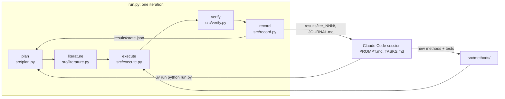

# micrograph-impact-lab

A research loop on optical micrographs of metals,
built at the [Claude Impact Lab Berlin 2026](https://github.com/xemantic/claude-impact-lab-2026)
(Claude Community × Foresight Institute).

**Status:** the loop runs on real data.
The first method (classical watershed) has a baseline on both datasets (`results/baseline/`); no live, tuned iteration yet.

Team: Ivan Logutov (engineer) and Cesare Garberino (scientist, materials).

## Question

> Can an agent loop tune a classical grain segmentation pipeline so that grain count and mean grain size on optical micrographs match ground truth within 10%,
> and how does accuracy degrade with image noise?

- **Why it is still open:** classical segmentation (threshold + watershed) needs hand-tuned parameters per material and image quality;
  the tuning is manual and rarely reported with error bars against ground truth.
- **Why it matters:** grain size governs strength and toughness of metals (Hall–Petch),
  and it is still often measured by hand on optical micrographs.
- **How a result is checked by computation:** an evaluator compares the pipeline's grains with ground truth:
  exact per-grain labels of synthetic micrographs, and expert grain-boundary masks of real 316L stainless steel.
  The loop tunes on a dev split; a holdout split is used once, at the end.
- **Design:** code measures, Claude tunes.
  A scikit-image pipeline segments and measures; the planner only chooses methods and parameters;
  the reviewer reads the metrics and looks at contour overlays. Claude never estimates sizes from pixels.

## Data

The dataset stays outside the repository.
Point `paths.dataset` in [config.yaml](config.yaml) at it, or set `MICROGRAPHS_DIR`.

- **316L stainless steel** (`02_316L_stainless_with_grain_masks/Grain/`): 816 real optical images, 400×300 RGB, with expert masks (1 = grain interior, 0 = boundary).
  Ground-truth grains are the 4-connected components of mask = 1; there is no scale bar, so sizes are in pixels.
  Warren et al. 2024, [Zenodo 10.5281/zenodo.22039777](https://doi.org/10.5281/zenodo.22039777), CC BY 4.0: download it from there.
  Split: the dataset's `val` folder (40) is dev, `test` (165) is holdout; `train` is not used.
  **The main claim of the project is measured on these real images.**
- **Synthetic** (`90_SYNTHETIC_exact_ground_truth`): 48 generated grayscale images, 1024×768, with exact labels per grain.
  Synthetic set (90_SYNTHETIC_exact_ground_truth): provenance unconfirmed, likely generated by an AI-written script on the day;
  generator code not available, so the images are not redistributed.
  Asked the scientist for the generator script (open question Q-1).
  The scientist confirmed that the set was generated with AI prompts and edited by hand, and that neither the prompts nor the code are available.
  **It is a testbed for tuning, not scientific evidence.**
  Checked against the files (all 36 complete rows):
  - `n_grains` counts all grains, edge-touching ones included.
  - `mean_eq_diameter_um` averages only grains with `touches_edge == 0`.
  - The evaluator compares like with like.
  The 12 `magset*` images (1.0 and 2.0 µm/px, no per-grain rows) are excluded.
  The other 36 are split per family, 24 dev / 12 holdout (`data/splits.json`, seed 0).
  The loop reads `corrupted/` (`corruption_level` 0.15–0.95).

The split is fixed in [data/splits.json](data/splits.json) (`uv run python -m src.splits` rebuilds it).
Only [src/evaluate.py](src/evaluate.py) reads ground truth.
Methods in `src/methods/` get image paths only; [tests/test_leakage.py](tests/test_leakage.py) fails if they mention ground truth or the split.

## The loop

Two loops work together.
The inner loop runs experiments and keeps one directory of evidence per iteration.
The outer loop is a Claude Code session that writes the methods the inner loop runs, and reads what it found.



| Step | What it does | Claude |
|---|---|---|
| plan | picks the next hypothesis, one of the existing methods, its parameters, and the target value that would count as success | planner |
| literature | searches the web for prior work, with citations; with `steps.literature: first_only`, only on iteration 1 | librarian, web search |
| execute | runs the method on the **dev** images, then the evaluator scores its grains; a crash is recorded, not raised | none |
| verify | checks the metric against the target and the method's own sanity checks, then asks for a critical review, with the contour overlays attached | reviewer |
| record | writes `summary.json`, updates `results/state.json`, appends to JOURNAL.md | none |

Models, effort, limits and paths are in [config.yaml](config.yaml).

## How to run

Requires [uv](https://docs.astral.sh/uv/).

```shell
uv sync
uv run pytest                     # the loop, end to end, without API calls (no dataset needed)
uv run python run.py --dry-run    # one iteration with canned answers on the dev split, written to results/_dry_run/
```

The method alone, on the dev split, without the API:

```shell
uv run python -m src.execute --dataset synthetic --out results/baseline/synthetic
uv run python -m src.execute --dataset 316L --out results/baseline/316L
```

A live run calls the Claude API and is billed.
It needs credentials: `ant auth login`, or `ANTHROPIC_API_KEY` in the environment.

```shell
uv run python run.py              # one iteration
uv run python run.py -n 5         # five iterations, up to limits.max_iterations in total
```

`eval.dataset` in config.yaml chooses which dataset the loop tunes on.
When tuning is done, the final exam runs the best dev iteration once on the holdout split
and writes `results/final.json` (dev vs holdout, and the gap); it refuses to run twice per dataset:

```shell
uv run python run.py --final
```

The outer loop runs in [Claude Code](https://claude.com/claude-code):

```
/goal <the goal, stated so it can be checked>
/loop 20m read @PROMPT.md and follow the instructions in it
```

## Results

> TODO: what the loop found, with links to `results/iter_NNN/`, how it was verified, and how confident we are.

The full record is in [JOURNAL.md](JOURNAL.md) and [results/](results/README.md).

### Where it got stuck

> TODO

### What it would need next

> TODO

## Repository

| Path | What it is |
|---|---|
| [config.yaml](config.yaml) | the question, models, limits and paths |
| [run.py](run.py) | the single entry point of the inner loop |
| [src/](src/) | one module per step, `src/methods/` with the methods the planner can choose, `src/evaluate.py` (the only reader of ground truth), `src/splits.py` |
| [data/splits.json](data/splits.json) | the fixed dev/holdout split |
| [tests/](tests/) | tests, written before the code they test |
| [data/sample/](data/sample/README.md) | a small subset of the data for development |
| [results/](results/README.md) | the state of every iteration, and its logs |
| [PROMPT.md](PROMPT.md) | the standing instruction for the outer loop |
| [TASKS.md](TASKS.md) | the live task queue |
| [JOURNAL.md](JOURNAL.md) | every result, decision and exchange, in order |
| [CLAUDE.md](CLAUDE.md) | context and rules for Claude Code |

## Licence

Code is licensed under the [Apache License 2.0](LICENSE),
and text under [CC BY 4.0](LICENSE-CC-BY-4.0),
the default of the Claude Impact Lab.
Data keeps the licence of its source, listed in [data/sample/](data/sample/README.md).
